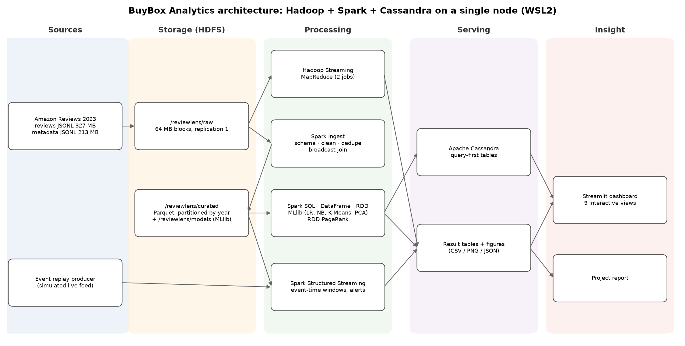

# BuyBox Analytics: Big Data Insights from Amazon Product Reviews

**Mini project, Big Data Analytics Laboratory (BIT27PE10 / BIT28PE10), B.Tech IT, PCCoE**

BuyBox Analytics is an end-to-end Big Data Analytics application. It ingests **540 MB of semi-structured JSON**
(701,528 Amazon reviews and 112,590 product records, *Amazon Reviews 2023, All_Beauty*). The data is stored in
**HDFS** and processed with **Hadoop MapReduce** and **Apache Spark** (SQL, DataFrame, RDD, MLlib, Structured
Streaming). Results are served from **Apache Cassandra** and explored in an interactive **Streamlit** dashboard.

The project report and presentation are submitted separately and are not part of this repository.



## What it does

| # | Module | Big Data technique | Insight produced |
|---|--------|-------------------|------------------|
| 0 | `scripts/hdfs_load.sh` | HDFS: put/ls/stat/fsck/setrep/get, 64 MB blocks | Data loaded and verified in distributed storage |
| 1 | `mapreduce/` | Hadoop Streaming MapReduce (Python mapper/combiner/reducer, custom counters) | Complaint word count; per-product rating histogram |
| 2 | `reviewlens/ingest.py` | Spark schema inference on nested JSON, PERMISSIVE mode, cleaning, dedup, broadcast join, Parquet partitioned by year | Curated data lake in HDFS (540 MB → 184 MB) |
| 3 | `reviewlens/analytics.py` | DataFrame API, Spark SQL (window functions), RDD `flatMap/reduceByKey` | Rating mix, trends, heatmaps, best/worst products and brands, complaint words/bigrams |
| 4 | `reviewlens/sentiment.py` | MLlib pipeline: tokenizer, n-grams, TF-IDF, Logistic Regression vs Naive Bayes | 95% accurate sentiment model; 5★ reviews hiding complaints |
| 5 | `reviewlens/graph_segments.py` | Self-join graph building, **PageRank on RDDs**, Louvain communities, K-Means + PCA | Co-review network, product communities, 5 product segments |
| 6 | `reviewlens/streaming.py` | Structured Streaming, event-time windows, watermarks, foreachBatch | Live daily KPIs and negative-spike alerts per product |
| 7 | `reviewlens/nosql.py` | Cassandra query-first data model, parallel load from Spark partitions, CRUD | 1.06 M rows served with ~5 ms single-partition reads |
| 8 | `reviewlens/performance.py` | JSON vs Parquet, partition/column pruning, caching, join strategy, parallelism, scalability | Measured speed-ups of each optimisation |
| 9 | `dashboard/app.py` | Time-series, heatmaps, network graph, high-dimensional (PCA) and streaming visualisations | Interactive insights dashboard |

## Project layout

```
bda mini project/
├── run_all.sh                 # one command: HDFS → MapReduce → Cassandra → Spark pipeline
├── run_pipeline.py            # Spark pipeline runner (--steps ingest,analytics,...)
├── requirements.txt
├── reviewlens/                # Spark application (one module per step)
│   ├── config.py  ingest.py  analytics.py  sentiment.py  graph_segments.py
│   └── streaming.py  nosql.py  performance.py  viz.py
├── mapreduce/                 # Hadoop Streaming jobs + runners
│   ├── wordcount_mapper.py  wordcount_reducer.py
│   ├── product_stats_mapper.py  product_stats_reducer.py
│   └── run_hadoop.sh  run_local.sh
├── hadoop/conf/               # single-node Hadoop config (core/hdfs/mapred/yarn-site.xml)
├── scripts/                   # setup_wsl.sh, env.sh, start_hadoop.sh, hdfs_load.sh,
│                              # start_cassandra.sh, stop_services.sh, run_step.sh
├── dashboard/app.py           # Streamlit dashboard (runs on Windows, no Spark needed)
├── data/raw/                  # dataset (not in the repo; downloaded automatically on first run)
└── outputs/                   # figures/*.png, tables/*.csv, summary.json (read by the dashboard)
```

## How to run

Everything big-data runs in **WSL2 Ubuntu** (Linux). Spark and Hadoop on plain Windows need
`winutils.exe`/`hadoop.dll`. The dashboard runs on Windows.

### 1. One-time setup (inside WSL, no sudo needed)

```bash
cd "/mnt/c/Users/Soham/Codes/random stuff/bda mini project"
bash scripts/setup_wsl.sh      # JDK 17, Python venv + packages, Cassandra 5.0 (Hadoop 3.3 reused from C:\hadoop)
```

### 2. Run the whole project (inside WSL)

```bash
bash run_all.sh                # ~12 minutes on a 16-thread laptop
```

This starts HDFS, loads the data, runs both MapReduce jobs, starts Cassandra, then runs all seven Spark steps
with input read from `hdfs://localhost:9000/reviewlens/raw`. To run single steps:

```bash
bash scripts/run_step.sh analytics,sentiment
bash mapreduce/run_local.sh    # MapReduce logic with Unix pipes, no Hadoop needed
RL_SAMPLE=0.2 bash scripts/run_step.sh ingest   # work on a 20% sample
```

Web UIs while it runs: HDFS NameNode at <http://localhost:9870>, Spark jobs at <http://localhost:4040>.
Stop everything with `bash scripts/stop_services.sh`.

### 3. Open the dashboard (Windows PowerShell)

```bash
.venv\Scripts\python -m streamlit run dashboard/app.py
```

(First time: `python -m venv .venv` and `.venv\Scripts\pip install streamlit plotly pandas`.)

`amazon_review_analytics.ipynb` is the earlier single-notebook (Colab) version of this idea. It is kept for
reference; the project above supersedes it.

## Notes from building it on Windows + WSL

* WSL stops background daemons when the command that started them exits, so the scripts launch Hadoop and
  Cassandra with `setsid`.
* The project folder has spaces in its path. Hadoop's `-files` option cannot handle that, so `run_hadoop.sh`
  ships the mapper and reducer from `/tmp`. Local paths are passed to Spark as plain `file://` URIs.
* Hadoop 3.3 on Java 17 needs `--add-opens` flags (set in `scripts/env.sh`).
* PySpark 3.5 on Python 3.12 needs `setuptools` for `distutils`.
